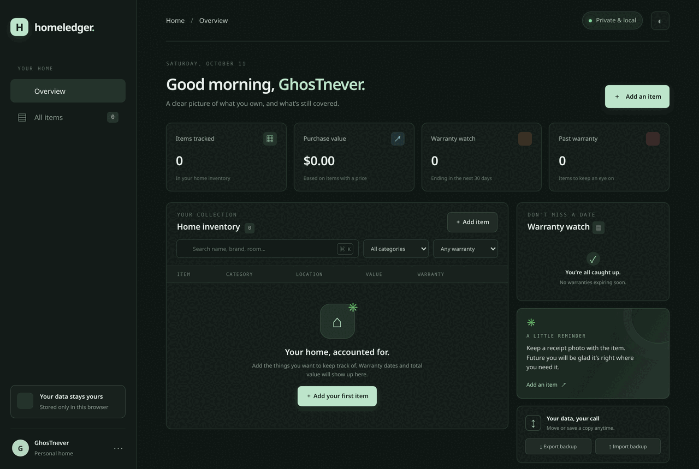

# HomeLedger

[](https://github.com/GhosTnever-lkm/homeledger/actions/workflows/ci.yml)
[](https://github.com/GhosTnever-lkm/homeledger/releases)

**Know what you own. Keep the details close.**



HomeLedger is a calm, local-first home inventory and warranty tracker. Keep a useful record of household items, where they live, what they cost, and when their warranty ends.

## Features

- At-a-glance item count, declared purchase value, upcoming warranty dates, and expired coverage.
- Search by item, brand, room, serial number, or notes; filter by category and warranty status.
- Add and edit records with purchase date, price, currency, brand, serial number, location, warranty, and notes.
- Local IndexedDB storage, with a localStorage fallback when IndexedDB is unavailable.
- Versioned JSON backup export and validated restore. Import asks before replacing the current catalog.
- Responsive layout, keyboard search shortcut (`Ctrl/⌘ + K`), and a light appearance option.
- No account, remote database, analytics, or third-party runtime dependencies.
- Warranty countdowns use the device's local calendar date and update with its day.

## Run locally

Requires Node.js 20 or newer.

```sh
npm run check
npm start
```

Open `http://127.0.0.1:4173`. The app needs to be served over HTTP; opening the HTML file directly may prevent browser modules from loading.

## Data and privacy

The catalog stays in this browser profile on this device. Clearing site data can remove it, so export a backup when you need a portable copy. The JSON backup includes item details and should be stored somewhere you trust. This first release does not encrypt backups, synchronize between devices, attach receipt images, or send reminders outside the open page.

Warranty labels are date-based reminders based on the date entered by the user. They are not a determination of legal coverage. Purchase totals are grouped by currency; different currencies are not converted or combined.

## Validation core

`core.mjs` validates the version-1 item schema and backup as data, not executable code. It limits backups to 5,000 items and 20 MB of JSON, rejects duplicate record IDs, validates actual calendar dates, and computes warranty status from an explicit `today` argument. The app uses a separate currency-aware total for display because values in different currencies must not be added together.

## Development

```sh
npm test
npm run check
```

## License

MIT. See [LICENSE](LICENSE).
